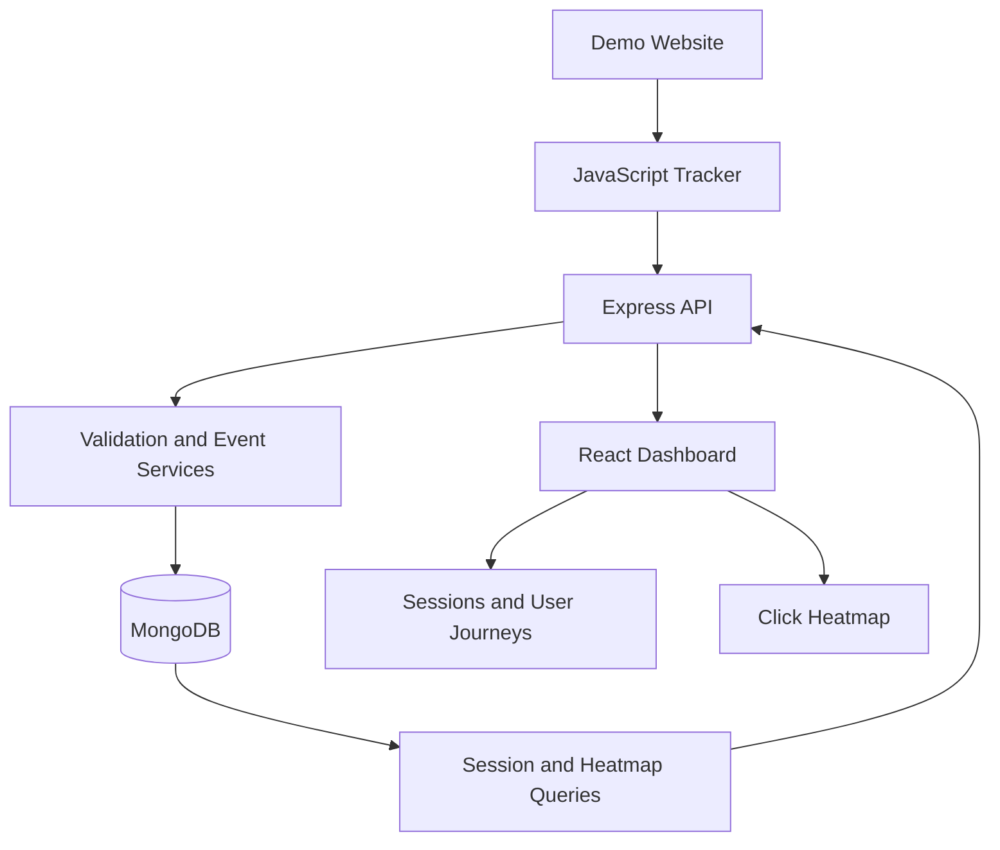

# TraceLens — User Behavior Analytics

**A full-stack web analytics application that captures user interactions and turns them into session-level insights.**

TraceLens was built for the **CausalFunnel Full Stack Engineer assignment**. It demonstrates how browser events can be collected, validated, persisted, and presented through an analytics dashboard.

The application includes a reusable JavaScript tracking script, a Node.js/Express API, MongoDB storage, a React dashboard, and a demo website for generating real interaction data.

## Key Features

- **Client-side event tracking:** Captures `page_view` and `click` events, including session identifier, page URL, timestamp, and click coordinates.
- **Event ingestion API:** Accepts and validates browser events before storing them.
- **Session analytics:** Lists sessions with event counts and supports pagination.
- **User journey timeline:** Retrieves session events in chronological order.
- **Click heatmap:** Displays recorded click coordinates for a selected page.
- **Interactive dashboard:** Provides session exploration, journey inspection, and heatmap navigation.
- **Guided onboarding:** Introduces first-time users to the dashboard's main features.
- **Automated tests:** Includes backend API/service tests and an optional integration suite against a dedicated MongoDB test database.

## Tech Stack

| Layer | Technologies |
|---|---|
| Frontend | React, Vite |
| Tracking | Vanilla JavaScript |
| Backend | Node.js, Express |
| Database | MongoDB, Mongoose |
| Testing | Backend API/service tests, MongoDB integration tests |

## Architecture



**Event flow:** A visitor interacts with the demo website → the tracker captures an event → the API validates and stores it → the dashboard queries sessions or click data → the user explores the resulting analytics.

## Getting Started

### Prerequisites

- Node.js 20 or newer
- npm 10 or newer
- MongoDB running locally or a MongoDB Atlas connection string

### 1. Clone the repository

```bash
git clone https://github.com/utkarsh-0106/tracelens.git
cd tracelens
```

### 2. Configure environment variables

Create a root `.env` file from the example:

```bash
cp .env.example .env
```

Review the values and update `MONGODB_URI` if your MongoDB instance uses a different connection string.

Example development configuration:

```dotenv
NODE_ENV=development
PORT=5000
MONGODB_URI=mongodb://127.0.0.1:27017/tracelens
CLIENT_ORIGINS=http://localhost:5173,http://localhost:5174
```

Keep `.env` private. Never commit credentials or production secrets.

### 3. Install dependencies

Run from the repository root:

```bash
npm install
```

### 4. Start MongoDB

Ensure your MongoDB server is running and accessible through `MONGODB_URI`.

### 5. Start the backend

In the first terminal:

```bash
npm run dev:server
```

The API uses port `5000` by default.

### 6. Start the dashboard

In a second terminal:

```bash
npm run dev:dashboard
```

Open [http://localhost:5173](http://localhost:5173).

### 7. Start the demo website

In a third terminal:

```bash
npm run dev:demo
```

Open [http://localhost:5174](http://localhost:5174).

Interact with the demo website to generate events, then use the dashboard to explore sessions, event timelines, and click heatmaps.

If a port is already occupied, identify the existing process before starting another server instance.

## API Reference

| Method | Endpoint | Purpose |
|---|---|---|
| `GET` | `/api/health` | Check API and database health |
| `POST` | `/api/events` | Ingest a `page_view` or `click` event |
| `GET` | `/api/sessions?page=1&limit=25` | List sessions and event counts |
| `GET` | `/api/sessions/:sessionId/events` | Retrieve a session's events chronologically |
| `GET` | `/api/heatmap/pages` | List pages with click data |
| `GET` | `/api/heatmap/clicks?pageUrl=<encoded-url>` | Retrieve click events for a page |

### Example event payload

```json
{
  "session_id": "sess_example123",
  "event_type": "click",
  "page_url": "http://localhost:5174/",
  "timestamp": "2026-10-12T15:30:00.000Z",
  "coordinates": {
    "x": 420,
    "y": 280
  },
  "viewport": {
    "width": 1440,
    "height": 900
  },
  "scroll": {
    "x": 0,
    "y": 0
  }
}
```

The example illustrates the documented event shape. Click coordinates are relevant to click events; `page_view` events do not require click coordinates.

## Environment Variables

| Variable | Description |
|---|---|
| `NODE_ENV` | Runtime environment |
| `PORT` | Backend server port |
| `MONGODB_URI` | Application database connection string |
| `MONGODB_TEST_URI` | Optional, separate MongoDB integration-test database |
| `CLIENT_ORIGINS` | Comma-separated list of allowed browser origins |

For integration testing, use the dedicated `tracelens_test` database. Never point the integration test at production data.

## Testing and Quality Checks

Run the backend API and service tests:

```bash
npm run test:server
```

Run both frontend production builds:

```bash
npm run build
```

Run the MongoDB integration suite:

```bash
export MONGODB_TEST_URI="mongodb://127.0.0.1:27017/tracelens_test"
npm run test:integration
```

The integration test is skipped if `MONGODB_TEST_URI` is not configured. It checks that the configured database is exactly `tracelens_test` and differs from `MONGODB_URI`. It clears the `events` collection in that dedicated test database before and after the test.

The documented test coverage includes event ingestion, click-coordinate validation, invalid payloads, malformed JSON, session counts and pagination, chronological event retrieval, heatmap queries, unknown routes, and sanitized server errors. The MongoDB integration suite additionally checks persisted ingestion, session aggregation, chronological retrieval, and heatmap queries against MongoDB.

Run a dependency security audit with:

```bash
npm audit
```

These commands let reviewers reproduce the checks locally. Run them against the final submitted version and report the actual results.

## Session and Coordinate Assumptions

- The tracker stores its identifier in `localStorage`. It therefore represents a persistent browser identifier rather than a strict, time-bounded visit session.
- Click positions are recorded in viewport coordinates alongside viewport dimensions and scroll offsets.
- Heatmap coordinates should be interpreted against a matching page layout and coordinate system. Layout changes or different viewport dimensions can affect alignment.

## Design Decisions and Trade-offs

- **Single event collection:** Keeps the assignment implementation straightforward and supports event retrieval and aggregation queries.
- **Persistent browser identifier:** Makes repeat interactions from the same browser easier to associate, but does not automatically define session expiration or inactivity-based sessions.
- **Coordinate-based heatmap:** Provides a lightweight visualization of recorded clicks without reconstructing page screenshots.
- **No authentication:** Authentication was outside the stated assignment scope.
- **Privacy-conscious tracking:** The tracker does not collect form values or passwords.

## Future Improvements

Potential next steps include time-bounded sessions, richer analytics and filtering, more advanced heatmap overlays, and additional production hardening for high event volumes.

## Assignment Context

TraceLens was developed as a demonstration of full-stack engineering across browser instrumentation, API design, data persistence, analytics queries, dashboard development, and automated testing.

**Repository:** [github.com/utkarsh-0106/tracelens](https://github.com/utkarsh-0106/tracelens)\n\n
## 🎬 TraceLens Launch Video

See how TraceLens transforms user interactions into actionable behavioral insights.

[](assets/tracelens-launch.mp4)\n\n**[▶ Watch the 20-second TraceLens launch video](assets/tracelens-launch.mp4)**\n