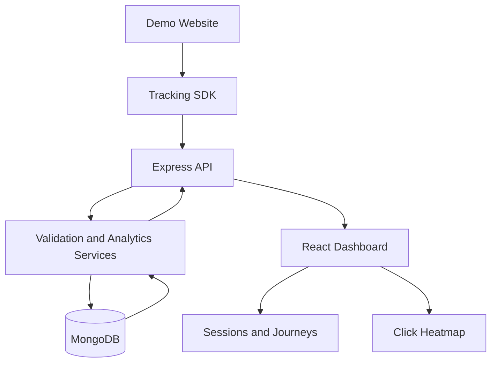

# TraceLens

TraceLens is a small website analytics application for the CausalFunnel Full Stack Engineer assignment. It collects page views and clicks through a reusable JavaScript tracker, stores events in MongoDB, and presents sessions, user journeys, and click heatmap data.

> Verification status: the core API tests and production builds passed on the prior version. Re-run the commands in Testing after installing dependencies to verify this updated tour and integration-test version.

## Features

- Express API with health check and event ingestion.
- MongoDB event storage through Mongoose.
- Reusable browser tracker with a persistent browser identifier.
- Demo website that emits real page-view and click events.
- React dashboard for sessions, session details, and click coordinates.
- Interactive guided tour for first-time users, covering sessions, journeys, the heatmap, and the demo site.
- Input validation, pagination for sessions, and basic API tests.

## Architecture



## Requirements

- Node.js 20 or newer
- npm 10 or newer
- MongoDB running locally, or a MongoDB Atlas connection string

## Local setup

1. Copy `.env.example` to `.env` in the repository root.
2. Set `MONGODB_URI` to your local or Atlas database.
3. Install dependencies from the repository root:

   ```bash
   npm install
   ```

4. Start the API:

   ```bash
   npm run dev:server
   ```

5. In separate terminals, start the dashboard and demo site:

   ```bash
   npm run dev:dashboard
   npm run dev:demo
   ```

6. Open the demo site at `http://localhost:5174` and the dashboard at `http://localhost:5173`.

The dashboard and demo app use Vite. Check each terminal's output if the ports differ.

## Environment variables

| Variable | Purpose |
|---|---|
| `NODE_ENV` | Runtime environment |
| `PORT` | Express API port |
| `MONGODB_URI` | Development/runtime MongoDB connection string |
| `MONGODB_TEST_URI` | Optional integration-test connection string; must target the separate `tracelens_test` database |
| `CLIENT_ORIGINS` | Comma-separated allowed browser origins |

Never commit `.env` or real database credentials.

## API

- `GET /api/health` — API and database status
- `POST /api/events` — ingest a `page_view` or `click`
- `GET /api/sessions?page=1&limit=25` — sessions and event counts
- `GET /api/sessions/:sessionId/events` — events for a session, chronologically
- `GET /api/heatmap/pages` — pages with click data
- `GET /api/heatmap/clicks?pageUrl=<encoded-url>` — click events for a page

Example event:

```json
{
  "session_id": "sess_example123",
  "event_type": "click",
  "page_url": "http://localhost:5174/",
  "timestamp": "2026-10-12T15:30:00.000Z",
  "coordinates": { "x": 420, "y": 280 },
  "viewport": { "width": 1440, "height": 900 },
  "scroll": { "x": 0, "y": 0 }
}
```

## Session and coordinate assumptions

The tracker stores an identifier in `localStorage`, so it behaves as a persistent browser identifier rather than a strict time-bounded visit session. Click positions are recorded in viewport coordinates alongside viewport size and scroll offsets. A heatmap overlay is only meaningful against a matching page layout and viewport/coordinate system.

## Testing

Run the backend API contract and service tests with:

```bash
npm run test:server
```

The default automated suite uses an isolated in-memory test service for API contract tests, so it does not read from or write to your development MongoDB database. Additional service tests verify query filters, chronological sorting, and aggregation pipeline pagination.

To run real MongoDB integration tests, ensure MongoDB is running and set `MONGODB_TEST_URI` to `mongodb://127.0.0.1:27017/tracelens_test` in your shell or root `.env`. The integration test refuses to run unless the database name is exactly `tracelens_test` and differs from `MONGODB_URI`. It clears only the `events` collection in that test database before and after the test; do not point it at production data. Run it with `npm run test:integration`. If `MONGODB_TEST_URI` is not set, the integration test is skipped.

Run both frontend production builds with:

```bash
npm run build
```

The default test suite covers valid event ingestion, click-coordinate requirements, invalid payloads, malformed JSON, session counts and pagination, chronological event retrieval, heatmap page/click queries, unknown routes, and sanitized server errors. The optional MongoDB integration suite verifies persisted ingestion, session aggregation, chronological retrieval, and heatmap queries against the isolated test database.

## Trade-offs and limitations

- This assignment-scale app uses a single event collection and aggregation queries.
- The tracker does not collect form values or passwords.
- No authentication is included because it is outside the assignment scope.
- The current heatmap is a coordinate visualization, not a screenshot reconstruction.
- Deployment links should be added only after deployment is completed and verified.
